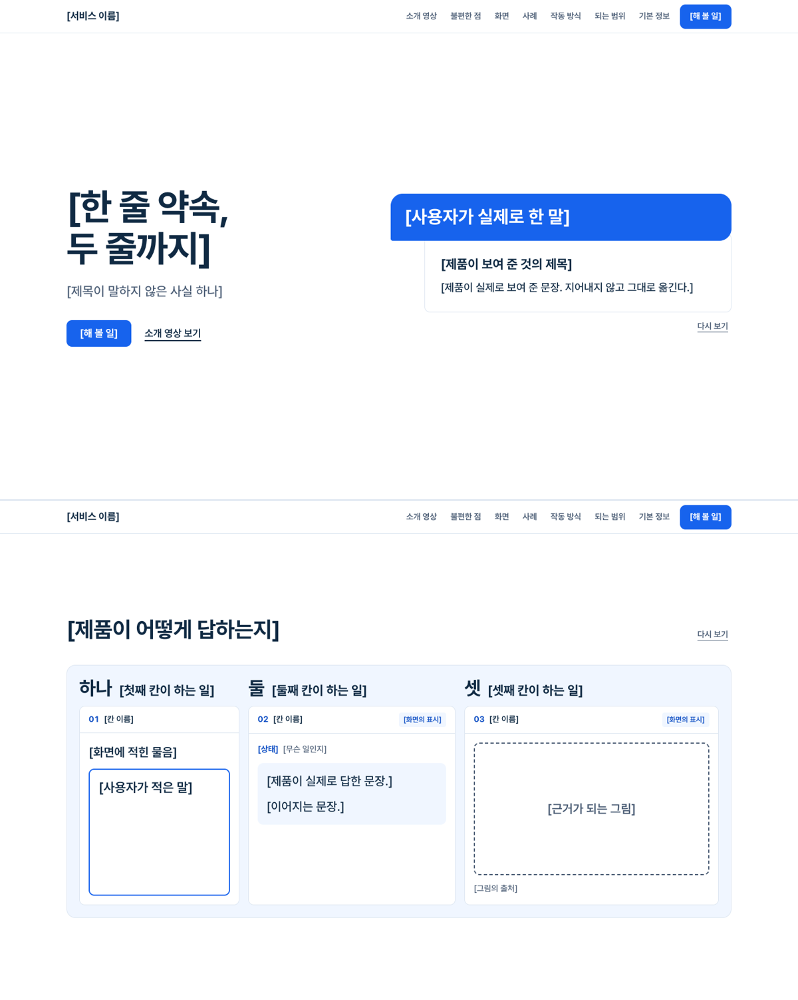

# no-slop-landing

AI가 찍어낸 티가 나지 않는 서비스 소개 페이지의 본과, 그 페이지를 만드는 지침.



## 들어 있는 것

| 파일 | 내용 |
|---|---|
| [GUIDE.md](GUIDE.md) | 소개 페이지 만드는 지침. AI에게 일을 맡길 때 같이 준다 |
| [template/index.html](template/index.html) | 본. 파일 하나에 다 들어 있고 빌드가 없다. 대괄호 `[ ]` 안이 채울 자리 |
| [examples/phone-keypad.html](examples/phone-keypad.html) | 제품에서 나온 장면의 예. 전화 메뉴 숫자판 |
| [check/check.py](check/check.py) | 점검 스크립트. 넘침, 누름 영역, 줄표, 그림 선명도, 화면 채움, 키보드 |

## 쓰는 법

1. `GUIDE.md` 1번의 네 가지(디자인 읽기, 세 값, 제품 색, 첫 화면 장면)를 먼저 정한다.
2. `template/`을 복사해 `:root`의 제품 색 네 개를 바꾼다.
3. 대괄호 자리를 실제 내용으로 채운다. 내용이 없는 구획은 지운다. 첫 화면의 장면은 새로 만든다.
4. 점검한다.

AI에게 맡길 때는 `GUIDE.md`와 `template/index.html`을 함께 주고, 서비스의 실제 화면과 문장을 자료로 준다.

## 점검

```bash
pip install playwright
python3 -m http.server 8000          # 저장소 폴더에서
python3 check/check.py http://127.0.0.1:8000/template/index.html --placeholders-ok
```

채운 페이지는 `--placeholders-ok` 없이 돌린다. 대괄호 자리가 하나라도 남으면 실패로 나온다.

스크립트가 못 보는 것(문구, 비어 보이는 구획, 그 서비스만의 장면인지)은 `GUIDE.md` 9번대로 사람이 본다.

## 본에 들어 있는 것

- 넓은 화면에서 구획 하나가 화면 하나를 채우고 구획 단위로 멈춘다. 좁은 화면에서는 내용 높이만큼만 쓴다.
- 장면 재생: 구획에 `data-scene`을 달면 그 화면에 들어올 때마다 재생하고, '다시 보기'로도 튼다.
- 구획 조각: 말풍선과 답 종이, 제품 화면의 칸, 사례 기록표, 번호 줄, 되는 것과 안 되는 것, 정의 목록.
- 좁은 화면의 메뉴, 건너뛰기 링크, 초점 테두리, 움직임 줄이기 설정 대응.
- 그라데이션, 그림자, 아이콘, 배지, 줄표, 화살표가 없다.

## 출처

- 지침의 바탕은 [antislop](https://github.com/miqdadbadjuber/anti-slop)(MIT)의 규칙이다. `GUIDE.md`는 그 규칙을 소개 페이지에 맞춰 직접 다시 쓴 것이고, 규칙 번호는 antislop의 번호다.
- 글꼴은 [Pretendard](https://github.com/orioncactus/pretendard)다. SIL Open Font License 1.1이며 전문은 [template/assets/fonts/LICENSE.txt](template/assets/fonts/LICENSE.txt)에 있다.

## 라이선스

[MIT](LICENSE). 글꼴 파일은 SIL Open Font License 1.1을 그대로 따른다. 다른 사람의 저작물과 그 조건은 [NOTICE.md](NOTICE.md)에 적었다.
